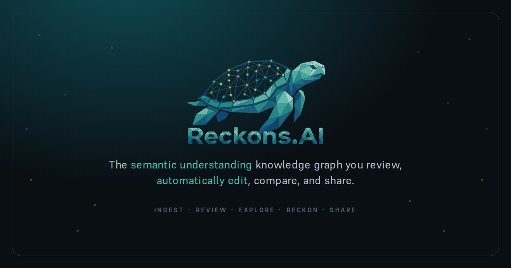

# Reckons.AI



[Open Reckons.AI](https://reckons.ai) · [Start here](https://reckons.ai/docs/learn/start-here) · [Documentation](https://reckons.ai/docs)

[](https://github.com/Data-Insight-Solutions/Reckons.AI/actions/workflows/ci.yml)

[](LICENSE)

**Turn scattered information into knowledge you can question, connect, and use.**

Reckons.AI is a [local-first](https://reckons.ai/docs/architecture/local-first-arch) personal knowledge app. Bring together notes, documents, and web pages; review the claims inside them; and build [spaces](https://reckons.ai/docs/features/multi-kb) of connected knowledge with the sources still in reach. When you need to make a decision, a [reckoning](https://reckons.ai/docs/learn/reckoning) helps you work through the situation, your target, and possible next steps.

Your graph is stored on your device. **Sharing and enabled integrations can send data elsewhere**, including cloud AI, web extraction, and sync. The [privacy boundaries](https://reckons.ai/docs/tips/no-telemetry) depend on the services and settings you use.

> **Alpha, actively developed.** The core workflow is usable, with rough edges and unfinished work. Documentation distinguishes built capabilities from plans; the live app can lag changes on `dev`. [Report an issue](https://github.com/Data-Insight-Solutions/Reckons.AI/issues).

## From information to understanding

[Add a source](https://reckons.ai/docs/features/ingest), then [review](https://reckons.ai/docs/features/review-system) the proposed claims: confirm, refine, or reject them. [Source excerpts](https://reckons.ai/docs/features/passage-grounding) help you check what the model extracted. AI can misread a source; review is part of the work. Sources you explicitly mark as trusted can have pending claims auto-confirmed.

Organize separate [spaces](https://reckons.ai/docs/features/multi-kb) for projects or interests, [link them](https://reckons.ai/docs/features/kb-leap), and explore their relationships in [2D or 3D](https://reckons.ai/docs/features/graph3-d). [Compare](https://reckons.ai/docs/features/compare) incoming knowledge with what you already hold to inspect additions and disagreements. [Sources](https://reckons.ai/docs/features/node-sources) let you trace a claim back to its recorded origin.

Ask [Shelly](https://reckons.ai/docs/features/shelly) about your graph or run a [reckoning](https://reckons.ai/docs/learn/reckoning). For example, bring together a project's requirements, constraints, and previous decisions, then ask what could achieve the next milestone. The output is a proposal to evaluate; its usefulness depends on your sources, reviewed claims, and model.

The [five moves](https://reckons.ai/docs/learn/what-it-does) explain the whole workflow. The [data model](https://reckons.ai/docs/learn/how-it-works) explains how statements, relationships, and provenance fit together.

## Your data, your connections

The core app uses a browser database and runs without a Reckons.AI account. Export your knowledge as standard [RDF/Turtle](https://reckons.ai/docs/triples-rdf/turtle), or link a [workspace folder](https://reckons.ai/docs/integrations-tech/integrations#workspace-sync) to keep a disk copy. Browser storage can be cleared or evicted, so keep backups of work you care about.

[Integrations](https://reckons.ai/docs/integrations-tech/integrations) extend that personal workspace:

- **Bring research together.** Import from the [browser extension](https://reckons.ai/docs/integrations-tech/integrations#browser-extension), GitHub repositories, and [calendars](https://reckons.ai/docs/integrations-tech/integrations#google-calendar). These connections have their own setup and access requirements.
- **Choose your AI and tools.** Use [local models](https://reckons.ai/docs/llm/local-models) in the browser or through [Ollama](https://reckons.ai/docs/integrations-tech/ollama), or configure [cloud providers and per-task backends](https://reckons.ai/docs/features/llm-backends). The [MCP server](https://reckons.ai/docs/integrations-tech/mcp-server) gives connected agents access to workspace graphs; those agents may use remote models.
- **Connect storage and automation.** Optional [Google Drive](https://reckons.ai/docs/integrations-tech/integrations#google-drive) and [self-hosted n8n](https://reckons.ai/docs/integrations-tech/n8n-cloud-sync) support backup, sync, and automation. They use services you configure; n8n is an optional integration, not a required app backend.

Cloud AI receives the content and graph context used for its task. URL ingestion uses Jina Reader or a configured scraper; remote OCR sends documents or images to its provider. Enabled sync can transfer graphs in the background. Local inference requires downloaded or sideloaded models, and Ollama is on-device only when its configured server is. “Prefer local” is a routing preference, not an offline lock. The hosted site also permits Cloudflare Web Analytics. See [privacy and network behavior](https://reckons.ai/docs/tips/no-telemetry), [model routing](https://reckons.ai/docs/features/prefer-local), and [safety limitations](SAFETY.md).

## Where it is going

The [roadmap space](static/reckons-roadmap.ttl) holds the detailed plans, status, dependencies, and open questions. Its themes build on the workflow above:

- **Knowledge you can check:** better extraction, retained source evidence, and clearer review decisions.
- **Spaces that stay understandable:** easier organization, navigation across spaces, and better performance as knowledge grows.
- **Useful assistance under your control:** stronger local models, optional integrations, and automation grounded in reviewed knowledge.
- **Knowledge you can carry forward:** portable files, more dependable sync and publishing, and eventually collaboration and team governance.

These are directions with work at different stages. The general integration plugin SDK remains speculative; seamless sync, autonomous assistance, and enterprise access controls are not completed capabilities.

## Get started

[Open the app](https://reckons.ai) and try the starter example, or run it locally with Node.js 22 or newer:

```bash
git clone https://github.com/Data-Insight-Solutions/Reckons.AI.git
cd Reckons.AI
npm ci
npm run dev
```

Open `http://localhost:5173`. An API key is optional: choose a local model or configure a provider in Settings. Browser inference needs model assets and compatible hardware; it can be slow, and model quality varies. Follow [SETUP.md](SETUP.md) for model setup, the extension, workspace folders, and self-hosting.

## Explore the documentation spaces

The linked terms above open pages generated from nodes in the documentation graphs. To explore their relationships in the app, open **Documentation Graph** from the welcome screen and follow its links between spaces. The public page links do not select a node in your local graph.

Start with the [guide](https://reckons.ai/docs/learn/start-here) ([source space](static/starter-guide.ttl)), then explore [features](https://reckons.ai/docs/learn/what-it-does) ([source space](static/docs-features.ttl)), [integrations](https://reckons.ai/docs/integrations-tech/integrations) ([source space](static/docs-integrations-tech.ttl)), or [architecture](https://reckons.ai/docs/architecture/local-first-arch) ([source space](static/docs-architecture.ttl)). The [roadmap](static/reckons-roadmap.ttl), [production](static/reckons-production.ttl), [testing](static/docs-testing.ttl), and [codebase](static/reckons-codebase.ttl) spaces describe the project itself.

Reckons.AI uses these graphs to plan and document its own development. The app is built with SvelteKit, TypeScript, Dexie, and Three.js; the standalone MCP server and CLI live alongside it. See [CONTRIBUTING.md](CONTRIBUTING.md) to contribute and [AGENTS.md](AGENTS.md) for the graph-first development workflow.
